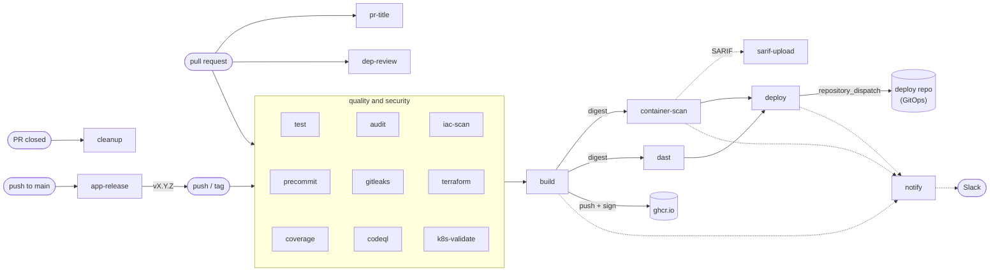
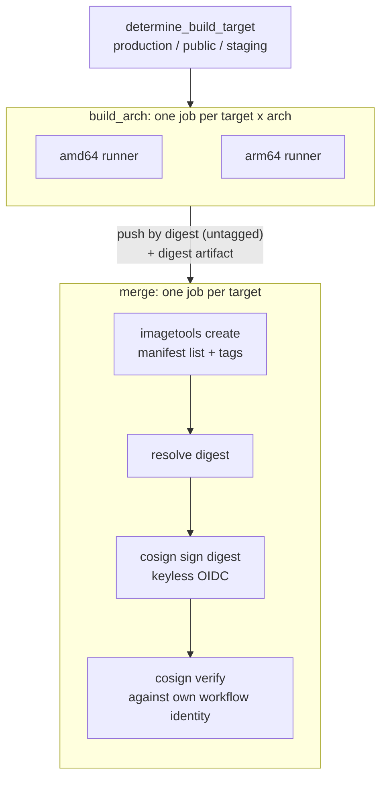

# centralized-workflow

Reusable GitHub Actions workflows for Rust services, covering the whole
delivery lifecycle: code quality, security and supply chain, multi-arch
container builds with keyless signing, image and runtime scanning, GitOps
deploys, infrastructure checks, releases and housekeeping. Application repos
call them with `uses:` instead of copying pipeline YAML.

Every action is pinned to a commit SHA, every job starts with
`harden-runner`, and every workflow is exercised on real runners by
[pen-pal/centralized-workflow-test](https://github.com/pen-pal/centralized-workflow-test)
before a release.

| Area | Workflow | What it does |
| --- | --- | --- |
| Code quality | [`test.yml`](.github/workflows/test.yml) | `cargo test`, `fmt --check`, `clippy -D warnings`, unused (`cargo-udeps`) and outdated dependency report |
| | [`precommit.yml`](.github/workflows/precommit.yml) | Runs the caller's `.pre-commit-config.yaml`, output in the job summary |
| | [`coverage.yml`](.github/workflows/coverage.yml) | `cargo llvm-cov` line coverage with an optional minimum, lcov artifact |
| | [`pr-title.yml`](.github/workflows/pr-title.yml) | Conventional Commit PR titles |
| Security | [`audit.yml`](.github/workflows/audit.yml) | `cargo audit` (RustSec), `cargo pants` (OSS Index), `cargo deny check` |
| | [`gitleaks.yml`](.github/workflows/gitleaks.yml) | Secret scan of the full git history |
| | [`codeql.yml`](.github/workflows/codeql.yml) | CodeQL SAST for Rust and for the workflow files |
| | [`dep-review.yml`](.github/workflows/dep-review.yml) | Blocks PRs that add vulnerable or denied-license dependencies |
| | [`iac-scan.yml`](.github/workflows/iac-scan.yml) | Trivy misconfiguration scan: Dockerfile, Terraform, Kubernetes, Helm |
| | [`ossf-scorecard.yml`](.github/workflows/ossf-scorecard.yml) | OpenSSF Scorecard of the repo's security practices |
| | [`sarif-upload.yml`](.github/workflows/sarif-upload.yml) | Sends SARIF artifacts (e.g. per-arch Trivy) to code scanning |
| Build and ship | [`build.yml`](.github/workflows/build.yml) | amd64 + arm64 images on native runners with SBOM and provenance, manifest list per target, cosign keyless signing |
| | [`container-scan.yml`](.github/workflows/container-scan.yml) | Anchore, SBOM, Trivy (gating) and optional Docker Scout, every arch, by digest |
| | [`dast.yml`](.github/workflows/dast.yml) | Runs the image and scans it with the OWASP ZAP baseline |
| | [`deploy.yml`](.github/workflows/deploy.yml) | Picks the environment from the ref, sends `repository_dispatch` to a GitOps repo |
| Infrastructure | [`terraform.yml`](.github/workflows/terraform.yml) | `terraform fmt`, `validate`, `tflint` |
| | [`k8s-validate.yml`](.github/workflows/k8s-validate.yml) | `helm lint`, `helm template` and kubeconform schema validation |
| Release and housekeeping | [`app-release.yml`](.github/workflows/app-release.yml) | release-please: release PR, changelog, `vX.Y.Z` tag and GitHub release |
| | [`cleanup.yml`](.github/workflows/cleanup.yml) | Deletes a closed PR's Actions caches |
| | [`notify.yml`](.github/workflows/notify.yml) | Slack alert with status and per-stage durations |

Inputs, outputs and required permissions: [docs/reference.md](docs/reference.md).
Maintainers: releases follow the checklist in [RELEASING.md](RELEASING.md).

## Architecture

Each box is one reusable workflow; the caller decides the order with `needs:`.



Inside `build.yml`:



Design choices:

- **Native runners per arch.** No QEMU emulation for the build itself. The
  arm64 leg defaults to `ubuntu-24.04-arm`.
- **Push by digest, tag at merge.** Each arch pushes an untagged image. The
  merge job creates one manifest list per Dockerfile target and applies the
  tags, so per-arch builds never race on a tag.
- **Sign the digest, not tags.** The signature covers every tag that points
  at the digest, and a tag moved later does not inherit it.
- **Identity from the token.** Verification reads `job_workflow_ref` from
  the job's own OIDC token, so it keeps working when the repo is renamed,
  forked, or called at a tag or SHA.
- **Scan and deploy what was signed.** `build.yml` outputs the signed
  manifest list digest. Pass it to `container-scan.yml`, which scans each
  arch's own image by digest, and to `deploy.yml`, which forwards it to the
  deploy repo. A tag overwritten in between changes nothing.
- **Layer cache** uses the GitHub Actions cache backend (`type=gha`), scoped
  per target and arch.

### Environment rules

`build.yml` (GitHub environment for the build job) and `deploy.yml` (target
folder in the deploy repo) classify the ref the same way:

| Ref | build environment | deploy folder |
| --- | --- | --- |
| tag `v*` without `-pub` `-beta` `-test` `-dev` `-rc` | `production` | `production` |
| tag containing `-pub` or `-beta` | `public` | `public` |
| anything else (branches, other tags) | `staging` | `branch_slug` with `/` replaced by `-` |

`deploy.yml` skips pull requests.

## Usage

Pin the reference: `@v1` tracks the latest v1.x release; for an immutable pin use a commit SHA.
See [Which ref to pin](RELEASING.md#which-ref-to-pin). Each example below is
a complete caller workflow; mix and match.

### Build, scan and deploy

```yaml
name: CI

on:
  push:
    branches: [main]
    tags: ['v*']
  pull_request:

concurrency:
  group: ${{ github.workflow }}-${{ github.ref }}
  cancel-in-progress: ${{ github.event_name == 'pull_request' }}

permissions:
  contents: read

jobs:
  precommit:
    uses: pen-pal/centralized-workflow/.github/workflows/precommit.yml@v1

  test:
    uses: pen-pal/centralized-workflow/.github/workflows/test.yml@v1

  audit:
    permissions:
      contents: read
      checks: write
      issues: write
    uses: pen-pal/centralized-workflow/.github/workflows/audit.yml@v1

  build:
    needs: [precommit, test]
    permissions:
      contents: read
      packages: write
      id-token: write
    uses: pen-pal/centralized-workflow/.github/workflows/build.yml@v1
    with:
      sha: ${{ github.sha }}
      repo_name: ${{ github.event.repository.name }}
      build_args: |
        FEATURES=${{ vars.FEATURES }}

  scan:
    needs: build
    permissions:
      packages: read
      pull-requests: write
    uses: pen-pal/centralized-workflow/.github/workflows/container-scan.yml@v1
    with:
      sha: ${{ github.sha }}
      digest: ${{ needs.build.outputs.digest }}
      repo_name: ${{ github.event.repository.name }}
      sarif: true # per-arch Trivy results for the Security tab

  scan-sarif:
    needs: scan
    permissions:
      security-events: write
    uses: pen-pal/centralized-workflow/.github/workflows/sarif-upload.yml@v1

  dast:
    needs: build
    permissions:
      contents: read
      packages: read
    uses: pen-pal/centralized-workflow/.github/workflows/dast.yml@v1
    with:
      image: ghcr.io/${{ github.repository }}@${{ needs.build.outputs.digest }}
      port: 8080

  deploy:
    needs: [build, scan, dast]
    if: github.event_name != 'pull_request'
    uses: pen-pal/centralized-workflow/.github/workflows/deploy.yml@v1
    with:
      sha: ${{ github.sha }}
      digest: ${{ needs.build.outputs.digest }}
      branch_slug: ${{ github.ref_name }}
      repo_name: ${{ github.event.repository.name }}
      app_name: my-app
    secrets:
      DISPATCH_PAT: ${{ secrets.DISPATCH_PAT }}
      DEPLOY_REPO: ${{ secrets.DEPLOY_REPO }}

  notify:
    needs: [precommit, build, scan, deploy]
    if: always()
    uses: pen-pal/centralized-workflow/.github/workflows/notify.yml@v1
    with:
      sha: ${{ github.sha }}
      branch_slug: ${{ github.ref_name }}
      repo_name: ${{ github.event.repository.name }}
      commit_message: ${{ github.event.head_commit.message || github.event.pull_request.title }}
      commit_url: ${{ github.event.head_commit.url || github.event.pull_request.html_url }}
      commit_actor: ${{ github.actor }}
      event_name: ${{ github.event_name }}
      workflow_name: ${{ github.workflow }}
      run_url: ${{ github.server_url }}/${{ github.repository }}/actions/runs/${{ github.run_id }}
      job_status: ${{ contains(needs.*.result, 'failure') && 'failure' || contains(needs.*.result, 'cancelled') && 'cancelled' || 'success' }}
      precommit_duration: ${{ needs.precommit.outputs.precommit_duration }}
      build_duration: ${{ needs.build.outputs.build_duration }}
      anchore_scan_duration: ${{ needs.scan.outputs.anchore_scan_duration }}
      anchore_sbom_scan_duration: ${{ needs.scan.outputs.anchore_sbom_scan_duration }}
      trivy_scan_duration: ${{ needs.scan.outputs.trivy_scan_duration }}
      deploy_duration: ${{ needs.deploy.outputs.deploy_duration }}
    secrets:
      SLACK_WEBHOOK_URL: ${{ secrets.SLACK_WEBHOOK_URL }}
```

Notes:

- **Permissions.** A called workflow can only narrow the caller's token, so
  grant per job what [docs/reference.md](docs/reference.md) lists.
- **GHCR without a PAT.** `build.yml` and `container-scan.yml` fall back to
  `GITHUB_TOKEN`. That works when the package is new or already linked to
  the calling repo. Pass `GH_ACTION_PAT` / `GH_ACTION_ACTOR` otherwise, or
  when the Dockerfile needs to fetch private dependencies.
- **Private build secrets.** The build mounts `github_token` and
  `github_username` as BuildKit secrets
  (`RUN --mount=type=secret,id=github_token ...`).
- **Pull requests** still build and push the image (untagged by digest plus
  the SHA tag) so it can be scanned; `deploy.yml` skips them.
- **Code scanning** (SARIF uploads, CodeQL, Scorecard) is free on public
  repos; private repos need GitHub Advanced Security. Without it, set
  `sarif: false` and skip `codeql.yml`, `ossf-scorecard.yml` and `sarif-upload.yml`.

### Pull request checks

```yaml
name: PR

on:
  pull_request:
    types: [opened, edited, synchronize, reopened, closed]

permissions: {}

jobs:
  title:
    if: github.event.action != 'closed'
    permissions:
      pull-requests: read
    uses: pen-pal/centralized-workflow/.github/workflows/pr-title.yml@v1

  dependencies:
    if: github.event.action != 'closed'
    permissions:
      contents: read
      pull-requests: write
    uses: pen-pal/centralized-workflow/.github/workflows/dep-review.yml@v1
    with:
      deny_licenses: GPL-3.0-only, AGPL-3.0-only

  cleanup:
    if: github.event.action == 'closed'
    permissions:
      actions: write
    uses: pen-pal/centralized-workflow/.github/workflows/cleanup.yml@v1
```

### Security and infrastructure

```yaml
name: Security

on:
  push:
    branches: [main]
  pull_request:
  schedule:
    - cron: '0 6 * * 1'

permissions: {}

jobs:
  secrets:
    permissions: { contents: read, security-events: write }
    uses: pen-pal/centralized-workflow/.github/workflows/gitleaks.yml@v1

  codeql:
    permissions: { contents: read, actions: read, security-events: write }
    uses: pen-pal/centralized-workflow/.github/workflows/codeql.yml@v1

  iac:
    permissions: { contents: read, security-events: write }
    uses: pen-pal/centralized-workflow/.github/workflows/iac-scan.yml@v1

  scorecard:
    if: github.event_name != 'pull_request'
    permissions: { contents: read, actions: read, security-events: write }
    uses: pen-pal/centralized-workflow/.github/workflows/ossf-scorecard.yml@v1

  coverage:
    permissions: { contents: read }
    uses: pen-pal/centralized-workflow/.github/workflows/coverage.yml@v1
    with:
      min_coverage: 70

  terraform:
    permissions: { contents: read }
    uses: pen-pal/centralized-workflow/.github/workflows/terraform.yml@v1
    with:
      working_directory: infra/terraform

  k8s:
    permissions: { contents: read }
    uses: pen-pal/centralized-workflow/.github/workflows/k8s-validate.yml@v1
    with:
      manifests_path: deploy/k8s
      chart_path: deploy/chart
```

### App releases

Conventional Commit messages (enforced on PR titles by `pr-title.yml`) drive
the version. release-please keeps a release PR open; merging it tags
`vX.Y.Z`, which `build.yml` and `deploy.yml` treat as production.

```yaml
name: Release

on:
  push:
    branches: [main]

permissions: {}

jobs:
  release:
    permissions:
      contents: write
      pull-requests: write
      issues: write
    uses: pen-pal/centralized-workflow/.github/workflows/app-release.yml@v1
    secrets:
      RELEASE_TOKEN: ${{ secrets.RELEASE_TOKEN }} # so the new tag starts the CI workflow
```

Without `RELEASE_TOKEN`, enable "Allow GitHub Actions to create and approve
pull requests" and run the build in this workflow behind
`if: needs.release.outputs.release_created == 'true'`.

## Reference

Every input, output, secret and required permission is in
[docs/reference.md](docs/reference.md).

## Verifying an image signature

Images are signed keyless by the `build.yml` workflow itself, so the
certificate identity is this workflow at the ref the caller used:

```sh
cosign verify \
  --certificate-identity "https://github.com/pen-pal/centralized-workflow/.github/workflows/build.yml@refs/heads/main" \
  --certificate-oidc-issuer "https://token.actions.githubusercontent.com" \
  ghcr.io/<owner>/<repo>:<sha>
```

Replace `refs/heads/main` with the ref your caller pins, e.g. `refs/tags/v1`.
The build log prints the exact command for each image.

Read the attestations BuildKit attached:

```sh
docker buildx imagetools inspect ghcr.io/<owner>/<repo>:<sha> --format '{{ json .SBOM }}'
docker buildx imagetools inspect ghcr.io/<owner>/<repo>:<sha> --format '{{ json .Provenance }}'
```

## Security

- Every action is pinned to a commit SHA, with the version in a trailing
  comment. Dependabot proposes updates weekly, with a 14 day cooldown.
- Every workflow defaults to empty or read-only token permissions; jobs
  ask only for what they use.
- Caller-controlled values reach scripts through `env:`, never through
  `${{ }}` inside `run:`. The deploy payload is built with `toJSON`.
- `step-security/harden-runner` runs in audit mode on every job.
- Tools fetched as release binaries (gitleaks, kubeconform, pre-commit) are
  verified against a pinned SHA-256 before use.
- This repo scans itself with its own workflows
  ([`self-security.yml`](.github/workflows/self-security.yml): CodeQL on the
  workflow files, gitleaks, Scorecard) on every push and weekly.
- Report vulnerabilities privately; see [SECURITY.md](SECURITY.md).

## Development

[`lint.yml`](.github/workflows/lint.yml) runs on every push and pull request
to this repo:

- **actionlint** checks syntax, expressions, and shellcheck on every
  `run:` block.
- **zizmor** runs a security audit.

[`self-security.yml`](.github/workflows/self-security.yml) also runs CodeQL,
gitleaks and Scorecard on this repo.

Run the same checks locally:

```sh
actionlint .github/workflows/*.yml
zizmor .github/workflows/
```

To exercise a workflow end to end, call it from a scratch repo with a small
crate and run it with [act](https://github.com/nektos/act):

```yaml
# scratch-repo/.github/workflows/ci.yml, with this repo's workflow copied
# into scratch-repo/.github/workflows/
on: push
jobs:
  test:
    uses: ./.github/workflows/test.yml
```

```sh
act push -W .github/workflows/ci.yml -P ubuntu-latest=catthehacker/ubuntu:act-24.04
```

Most workflows need GHCR, code scanning or real tokens.
[pen-pal/centralized-workflow-test](https://github.com/pen-pal/centralized-workflow-test)
calls every workflow except `notify.yml` at `@main` on real runners, with a
Rust crate, Dockerfile, Terraform, Kubernetes and Helm fixtures, and asserts
the results: tags, multi-arch manifests, signatures, attestations, scan and
DAST results, the deploy payload, coverage and every output. Its suites
(`build.yml`, `rust.yml`, `security.yml`, `infra.yml`) gate every release and
run weekly; `pr.yml` and `app-release.yml` cover the pull request and
release-please flows.

### Releasing

`main` is the staging line; callers pin `@v1`. The
[`release.yml`](.github/workflows/release.yml) workflow checks that Lint and
the test repo passed on the head of `main`, tags the next `vX.Y.Z`, publishes
the release notes and moves `vX`:

```sh
gh workflow run release.yml -R pen-pal/centralized-workflow -f bump=patch
```

[RELEASING.md](RELEASING.md) covers the versioning policy, which ref to
pin, the full cycle, hotfixes, rollback and major versions.

## License

[GPL-3.0](LICENSE)
