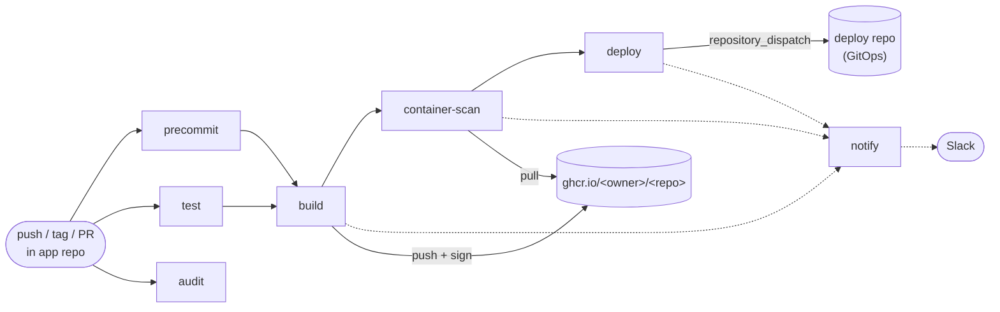
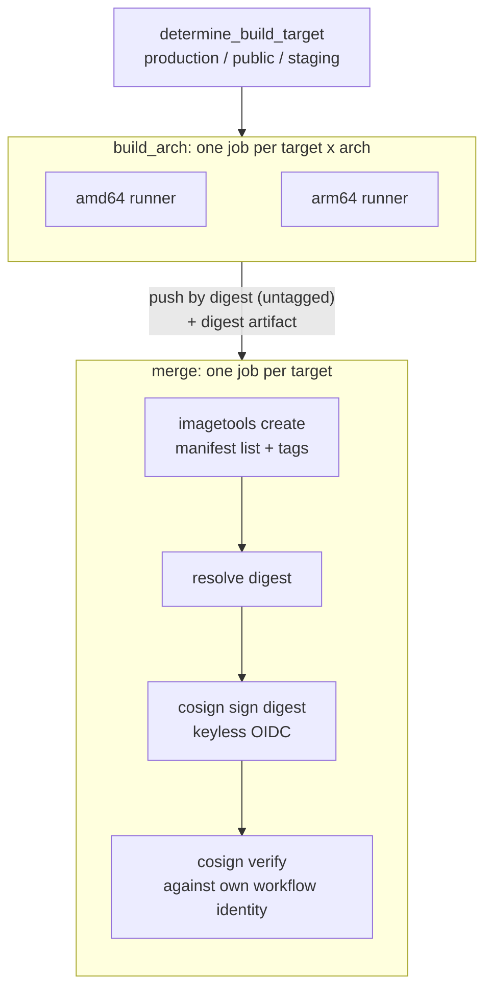

# centralized-workflow

Reusable GitHub Actions workflows for Rust services. One place to maintain
testing, linting, supply-chain audits, multi-arch container builds with
keyless signing, image scanning, GitOps deploy triggers and Slack alerts.
Application repos call them with `uses:` instead of copying pipeline YAML.

| Workflow | What it does |
| --- | --- |
| [`test.yml`](.github/workflows/test.yml) | `cargo test`, `cargo fmt --check`, `clippy -D warnings`, unused (`cargo-udeps`) and outdated dependency report |
| [`precommit.yml`](.github/workflows/precommit.yml) | Runs the caller's `.pre-commit-config.yaml` and posts the output to the job summary |
| [`audit.yml`](.github/workflows/audit.yml) | `cargo audit` (RustSec), `cargo pants` (OSS Index), `cargo deny check` |
| [`build.yml`](.github/workflows/build.yml) | Builds amd64 + arm64 images on native runners with SBOM and provenance attestations, pushes to GHCR, merges a manifest list per target, signs and verifies it with cosign |
| [`container-scan.yml`](.github/workflows/container-scan.yml) | Anchore, SBOM, Trivy (gating) and optional Docker Scout scans of every arch, by digest |
| [`deploy.yml`](.github/workflows/deploy.yml) | Works out the target environment from the ref and sends `repository_dispatch` to a GitOps deploy repo |
| [`notify.yml`](.github/workflows/notify.yml) | Slack alert with commit details, status and per-stage durations |

## Architecture

A typical caller pipeline. Each box is one reusable workflow; the caller
decides the order with `needs:`.



Inside `build.yml`:



Design choices:

- **Native runners per arch.** No QEMU emulation for the build itself. The
  arm64 leg defaults to `ubuntu-24.04-arm`.
- **Push by digest, tag at merge.** Each arch pushes an untagged image. The
  merge job creates one manifest list per Dockerfile target and applies the
  tags, so per-arch builds never race on a tag.
- **Sign the digest, not tags.** The signature covers every tag that points
  at the digest, and a tag moved later does not inherit it.
- **Identity from the token.** Verification reads `job_workflow_ref` from
  the job's own OIDC token, so it keeps working when the repo is renamed,
  forked, or called at a tag or SHA.
- **Scan and deploy what was signed.** `build.yml` outputs the signed
  manifest list digest. Pass it to `container-scan.yml`, which scans each
  arch's own image by digest, and to `deploy.yml`, which forwards it to the
  deploy repo. A tag overwritten in between changes nothing.
- **Layer cache** uses the GitHub Actions cache backend (`type=gha`), scoped
  per target and arch.

### Environment rules

`build.yml` (GitHub environment for the build job) and `deploy.yml` (target
folder in the deploy repo) classify the ref the same way:

| Ref | build environment | deploy folder |
| --- | --- | --- |
| tag `v*` without `-pub` `-beta` `-test` `-dev` `-rc` | `production` | `production` |
| tag containing `-pub` or `-beta` | `public` | `public` |
| anything else (branches, other tags) | `staging` | `branch_slug` with `/` replaced by `-` |

`deploy.yml` skips pull requests.

## Usage

Pin the reference: `@v1` tracks the latest v1.x release; for an immutable pin use a commit SHA.

```yaml
name: CI

on:
  push:
    branches: [main]
    tags: ['v*']
  pull_request:

concurrency:
  group: ${{ github.workflow }}-${{ github.ref }}
  cancel-in-progress: ${{ github.event_name == 'pull_request' }}

permissions:
  contents: read

jobs:
  precommit:
    uses: pen-pal/centralized-workflow/.github/workflows/precommit.yml@v1

  test:
    uses: pen-pal/centralized-workflow/.github/workflows/test.yml@v1

  audit:
    permissions:
      contents: read
      checks: write
      issues: write
    uses: pen-pal/centralized-workflow/.github/workflows/audit.yml@v1

  build:
    needs: [precommit, test]
    permissions:
      contents: read
      packages: write
      id-token: write
    uses: pen-pal/centralized-workflow/.github/workflows/build.yml@v1
    with:
      sha: ${{ github.sha }}
      repo_name: ${{ github.event.repository.name }}
      build_args: |
        FEATURES=${{ vars.FEATURES }}

  scan:
    needs: build
    permissions:
      packages: read
      pull-requests: write
    uses: pen-pal/centralized-workflow/.github/workflows/container-scan.yml@v1
    with:
      sha: ${{ github.sha }}
      digest: ${{ needs.build.outputs.digest }}
      repo_name: ${{ github.event.repository.name }}

  deploy:
    needs: [build, scan]
    if: github.event_name != 'pull_request'
    uses: pen-pal/centralized-workflow/.github/workflows/deploy.yml@v1
    with:
      sha: ${{ github.sha }}
      digest: ${{ needs.build.outputs.digest }}
      branch_slug: ${{ github.ref_name }}
      repo_name: ${{ github.event.repository.name }}
      app_name: my-app
    secrets:
      DISPATCH_PAT: ${{ secrets.DISPATCH_PAT }}
      DEPLOY_REPO: ${{ secrets.DEPLOY_REPO }}

  notify:
    needs: [precommit, build, scan, deploy]
    if: always()
    uses: pen-pal/centralized-workflow/.github/workflows/notify.yml@v1
    with:
      sha: ${{ github.sha }}
      branch_slug: ${{ github.ref_name }}
      repo_name: ${{ github.event.repository.name }}
      commit_message: ${{ github.event.head_commit.message || github.event.pull_request.title }}
      commit_url: ${{ github.event.head_commit.url || github.event.pull_request.html_url }}
      commit_actor: ${{ github.actor }}
      event_name: ${{ github.event_name }}
      workflow_name: ${{ github.workflow }}
      run_url: ${{ github.server_url }}/${{ github.repository }}/actions/runs/${{ github.run_id }}
      job_status: ${{ contains(needs.*.result, 'failure') && 'failure' || contains(needs.*.result, 'cancelled') && 'cancelled' || 'success' }}
      precommit_duration: ${{ needs.precommit.outputs.precommit_duration }}
      build_duration: ${{ needs.build.outputs.build_duration }}
      anchore_scan_duration: ${{ needs.scan.outputs.anchore_scan_duration }}
      anchore_sbom_scan_duration: ${{ needs.scan.outputs.anchore_sbom_scan_duration }}
      trivy_scan_duration: ${{ needs.scan.outputs.trivy_scan_duration }}
      deploy_duration: ${{ needs.deploy.outputs.deploy_duration }}
    secrets:
      SLACK_WEBHOOK_URL: ${{ secrets.SLACK_WEBHOOK_URL }}
```

Notes:

- **Permissions.** A called workflow can only narrow the caller's token, so
  grant per job what the table below lists.
- **GHCR without a PAT.** `build.yml` and `container-scan.yml` fall back to
  `GITHUB_TOKEN`. That works when the package is new or already linked to
  the calling repo. Pass `GH_ACTION_PAT` / `GH_ACTION_ACTOR` otherwise, or
  when the Dockerfile needs to fetch private dependencies.
- **Private build secrets.** The build mounts `github_token` and
  `github_username` as BuildKit secrets
  (`RUN --mount=type=secret,id=github_token ...`).
- **Pull requests** still build and push the image (untagged by digest plus
  the SHA tag) so it can be scanned; `deploy.yml` skips them.

## Reference

Durations are whole seconds.

### test.yml

Needs `contents: read`.

| Input | Required | Default | Description |
| --- | --- | --- | --- |
| `runner` | no | `ubuntu-latest` | Runner label for the Rust jobs |

### precommit.yml

Needs `contents: read`. Installs stable (with rustfmt and clippy), nightly
(with rustfmt and clippy), `cargo-udeps`, Python and `pre-commit`.

| Input | Required | Default | Description |
| --- | --- | --- | --- |
| `runner` | no | `ubuntu-latest` | Runner label for the precommit job |

| Output | Description |
| --- | --- |
| `precommit_duration` | Seconds taken by the precommit job |

### audit.yml

Needs `contents: read`, `checks: write`, `issues: write`.

| Input | Required | Default | Description |
| --- | --- | --- | --- |
| `runner` | no | `ubuntu-latest` | Runner label for the cargo-deny job |

### build.yml

Needs `contents: read`, `packages: write`, `id-token: write`.

| Input | Required | Default | Description |
| --- | --- | --- | --- |
| `sha` | yes | | Image tag to publish, normally the commit SHA |
| `repo_name` | yes | | Image name under `ghcr.io/<owner>/` |
| `docker_targets` | no | `["final"]` | Dockerfile stages to build, as a JSON array. The first keeps plain tags, others get a `-<target>` suffix |
| `build_args` | no | | Extra docker build args, one `KEY=VALUE` per line. `ARCH` and `GITHUB_ORGANIZATION` are always set |
| `runner_amd64` | no | `ubuntu-latest` | Runner label for amd64 builds |
| `runner_arm64` | no | `ubuntu-24.04-arm` | Runner label for arm64 builds |
| `branch_slug`, `dependency_clone`, `dependency_repo`, `dependency_ref` | no | | Unused. Kept so existing callers that pass them do not break |

| Secret | Required | Description |
| --- | --- | --- |
| `GH_ACTION_PAT` | no | PAT for GHCR and private deps. Falls back to `GITHUB_TOKEN` |
| `GH_ACTION_ACTOR` | no | User for `GH_ACTION_PAT`. Falls back to `github.actor` |
| `GH_ACTION_USER` | no | Passed to the build as secret `github_username`. Falls back to `github.actor` |

| Output | Description |
| --- | --- |
| `build_duration` | Seconds taken by the last image build job to finish |
| `digest` | Manifest list digest (`sha256:...`) of the first docker target, as signed |

Tags: `<sha>`, plus `<version>` and `<major>.<minor>` on semver tags. Each
image carries BuildKit SBOM and provenance (`mode=min`) attestations.

### container-scan.yml

Needs `packages: read`, plus `pull-requests: write` for the Scout PR comment.

| Input | Required | Default | Description |
| --- | --- | --- | --- |
| `sha` | yes | | Image tag to scan. Ignored when `digest` is set |
| `digest` | no | | Manifest list digest to scan instead of the tag, normally `build.yml`'s `digest` output |
| `repo_name` | yes | | Image name under `ghcr.io/<owner>/` |
| `archs` | no | `["amd64", "arm64"]` | Architectures to scan, as a JSON array. `sbom` and `scout` run on amd64 only |
| `tools` | no | `["anchore", "sbom", "trivy"]` | Scanners to run, as a JSON array. Add `"scout"` only with `DOCKER_USER` / `DOCKER_PAT` set |
| `fail_severity` | no | `CRITICAL,HIGH` | Trivy fails the scan on fixable findings of these severities. Empty disables the gate |
| `branch_slug` | no | | Unused. Kept so existing callers that pass it do not break |

| Secret | Required | Description |
| --- | --- | --- |
| `GH_ACTION_PAT` | no | PAT for GHCR. Falls back to `GITHUB_TOKEN` |
| `GH_ACTION_ACTOR` | no | User for `GH_ACTION_PAT`. Falls back to `github.actor` |
| `DOCKER_USER` | no | Docker Hub user, needed for the scout tool |
| `DOCKER_PAT` | no | Docker Hub token, needed for the scout tool |

| Output | Description |
| --- | --- |
| `anchore_scan_duration` | Seconds taken by the anchore scan |
| `anchore_sbom_scan_duration` | Seconds taken by the sbom scan |
| `trivy_scan_duration` | Seconds taken by the trivy scan |
| `docker_scout_scan_duration` | Seconds taken by the scout scan |

### deploy.yml

Needs no token permissions; it uses `DISPATCH_PAT`. Sends event type
`update-image-tag` with payload `target_dir`, `repo_name`, `app_name`, `sha`,
`digest` (empty string when not passed).

| Input | Required | Description |
| --- | --- | --- |
| `sha` | yes | Image tag to deploy |
| `digest` | no | Image digest, normally `build.yml`'s `digest` output, forwarded so the deploy repo can pin it |
| `branch_slug` | yes | Branch name, used as the target folder for non-release refs |
| `repo_name` | yes | Source repo name, passed through to the deploy repo |
| `app_name` | yes | App name, passed through to the deploy repo |

| Secret | Required | Description |
| --- | --- | --- |
| `DISPATCH_PAT` | yes | PAT allowed to send `repository_dispatch` to the deploy repo |
| `DEPLOY_REPO` | yes | Name of the deploy (GitOps) repo under the same owner |

| Output | Description |
| --- | --- |
| `deploy_duration` | Seconds taken by the deploy job |

### notify.yml

Needs no token permissions.

| Input | Required | Description |
| --- | --- | --- |
| `sha`, `branch_slug`, `repo_name`, `commit_message`, `commit_url`, `commit_actor`, `event_name`, `workflow_name`, `run_url` | yes | Commit and run details shown in the alert |
| `job_status` | yes | One of `success`, `failure`, `started`, `cancelled` |
| `precommit_duration`, `build_duration`, `anchore_scan_duration`, `anchore_sbom_scan_duration`, `trivy_scan_duration`, `docker_scout_scan_duration`, `deploy_duration` | no | Shown as fields when set |

| Secret | Required | Description |
| --- | --- | --- |
| `SLACK_WEBHOOK_URL` | yes | Slack incoming webhook URL |

## Verifying an image signature

Images are signed keyless by the `build.yml` workflow itself, so the
certificate identity is this workflow at the ref the caller used:

```sh
cosign verify \
  --certificate-identity "https://github.com/pen-pal/centralized-workflow/.github/workflows/build.yml@refs/heads/main" \
  --certificate-oidc-issuer "https://token.actions.githubusercontent.com" \
  ghcr.io/<owner>/<repo>:<sha>
```

Replace `refs/heads/main` with the ref your caller pins, e.g. `refs/tags/v1`.
The build log prints the exact command for each image.

Read the attestations BuildKit attached:

```sh
docker buildx imagetools inspect ghcr.io/<owner>/<repo>:<sha> --format '{{ json .SBOM }}'
docker buildx imagetools inspect ghcr.io/<owner>/<repo>:<sha> --format '{{ json .Provenance }}'
```

## Security

- Every action is pinned to a commit SHA, with the version in a trailing
  comment. Dependabot proposes updates weekly, with a 14 day cooldown.
- Every workflow defaults to empty or read-only token permissions; jobs
  ask only for what they use.
- Caller-controlled values reach scripts through `env:`, never through
  `${{ }}` inside `run:`. The deploy payload is built with `toJSON`.
- `step-security/harden-runner` runs in audit mode on every job.

## Development

[`lint.yml`](.github/workflows/lint.yml) runs on every push and pull request
to this repo:

- **actionlint** checks syntax, expressions, and shellcheck on every
  `run:` block.
- **zizmor** runs a security audit.

Run the same checks locally:

```sh
actionlint .github/workflows/*.yml
zizmor .github/workflows/
```

To exercise a workflow end to end, call it from a scratch repo with a small
crate and run it with [act](https://github.com/nektos/act):

```yaml
# scratch-repo/.github/workflows/ci.yml, with this repo's workflow copied
# into scratch-repo/.github/workflows/
on: push
jobs:
  test:
    uses: ./.github/workflows/test.yml
```

```sh
act push -W .github/workflows/ci.yml -P ubuntu-latest=catthehacker/ubuntu:act-24.04
```

`build.yml`, `container-scan.yml` and `deploy.yml` need GHCR and real
tokens. [pen-pal/centralized-workflow-test](https://github.com/pen-pal/centralized-workflow-test)
calls every workflow except `notify.yml` at `@main` on real runners and
asserts the results: tags, multi-arch manifests, signatures, attestations,
the deploy payload and every output. It also runs weekly to catch upstream
breakage.

### Releasing

`main` is the staging line; callers pin `@v1`.

1. Merge to `main`.
2. Run the test repo against it:
   `gh workflow run build.yml -R pen-pal/centralized-workflow-test` and
   `gh workflow run rust.yml -R pen-pal/centralized-workflow-test`.
3. When both pass, publish a release `vX.Y.Z` from that commit.
   [`release.yml`](.github/workflows/release.yml) then moves `vX` to it.
   Prereleases and non-semver tags leave `vX` alone.

## License

[GPL-3.0](LICENSE)
