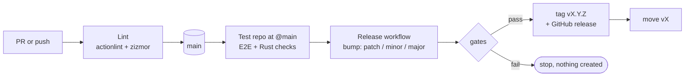

# Releasing

How versions of these reusable workflows are numbered, tested and published.

## Release checklist

Copy and follow top to bottom. Details for each step are further down.

```sh
R=pen-pal/centralized-workflow
T=pen-pal/centralized-workflow-test
```

- [ ] **1. Changes are on `main`** and Lint passed on the push:
      `gh run list -R $R -w "Lint workflows" -L 1`
- [ ] **2. README is current** if any input, output, secret or permission changed
      (the [Reference](README.md#reference) tables and the usage example).
- [ ] **3. Pick the bump** with the [versioning policy](#versioning-policy):
      `patch`, `minor` or `major`. For `major`, write the upgrade notes first
      ([Breaking changes](#breaking-changes-next-major)).
- [ ] **4. Run the test repo** against `main` and wait for both to pass:
      ```sh
      gh workflow run build.yml -R $T
      gh workflow run rust.yml  -R $T
      gh run list -R $T -w "E2E test" -L 1      # completed success
      gh run list -R $T -w "Rust checks" -L 1   # completed success
      ```
      Deploy fails if `DISPATCH_PAT` there has expired; see [Test repo upkeep](#test-repo-upkeep).
- [ ] **5. Dry run** the release and read the notes in the run summary:
      ```sh
      gh workflow run release.yml -R $R -f bump=patch -f dry_run=true
      gh run watch -R $R "$(gh run list -R $R -w Release -L 1 --json databaseId -q '.[0].databaseId')"
      ```
- [ ] **6. Release:**
      `gh workflow run release.yml -R $R -f bump=patch`
- [ ] **7. Check the result:**
      ```sh
      gh release view -R $R                       # new vX.Y.Z, notes link the test runs
      git ls-remote --tags https://github.com/$R  # vX and vX.Y.Z on the same commit
      ```
- [ ] **8. Major only:** put the upgrade notes above the generated ones, then tell callers:
      ```sh
      { cat upgrade.md; echo; gh release view vX.0.0 -R $R --json body -q .body; } > notes.md
      gh release edit vX.0.0 -R $R --notes-file notes.md
      ```

If a gate fails, the run says which one and how to fix it. Nothing is
created until every gate passes.

## Which ref to pin

| Pin | Moves? | Use when |
| --- | --- | --- |
| `@v1` | Yes, to every `v1.x.y` release | Default. Fixes and new optional features arrive without edits; nothing breaking does |
| `@v1.2.3` | No (by convention) | You want to choose when to upgrade |
| `@<commit sha>` | Never | You need an immutable pin. Dependabot can bump it |
| `@main` | Every merge | Only the test repo. `main` is the staging line, not a release |

The cosign signer identity follows the pin: an image built through `@v1` is
signed by `.../build.yml@refs/tags/v1`. Callers that verify signatures must
update their `--certificate-identity` when they change the pin.

## Versioning policy

Versions are [semver](https://semver.org/) over the **workflow interface**:
inputs, outputs, secrets, required permissions and observable behaviour.

| Bump | When | Examples |
| --- | --- | --- |
| **major** `v2.0.0` | An existing caller can break without editing anything | Remove or rename an input, output or secret; make an optional input required; need a new token permission (callers that do not grant it fail at startup); change a default so that a passing pipeline fails |
| **minor** `v1.3.0` | New capability, existing callers unaffected | New optional input or output; new scanner behind an opt-in; extra payload field |
| **patch** `v1.2.4` | No interface change | Bug fix; action pin or Dependabot bump; docs; log output |

New CVEs found by an unchanged scanner configuration are not a breaking
change. Note anything callers should act on at the top of the release notes.

## Release cycle



1. **Change.** Open a PR or push to `main`. [`lint.yml`](.github/workflows/lint.yml)
   runs actionlint and zizmor; both must pass.
2. **Test.** [pen-pal/centralized-workflow-test](https://github.com/pen-pal/centralized-workflow-test)
   calls every workflow except `notify.yml` at `@main` on real runners. It
   runs weekly; after a merge, start it by hand:

   ```sh
   gh workflow run build.yml -R pen-pal/centralized-workflow-test
   gh workflow run rust.yml  -R pen-pal/centralized-workflow-test
   ```

3. **Release.** Run [`release.yml`](.github/workflows/release.yml) on `main`,
   from the Actions tab or:

   ```sh
   gh workflow run release.yml -R pen-pal/centralized-workflow -f bump=patch -f dry_run=true   # check first
   gh workflow run release.yml -R pen-pal/centralized-workflow -f bump=patch
   ```

   The workflow:

   1. **Checks the gates** and stops before creating anything if one fails:
      - it runs on the current head of `main`;
      - Lint passed on the push of that commit;
      - both test repo suites (`build.yml`, `rust.yml`) passed in a run that
        started after that push, so they ran this code.
   2. **Computes the version** by bumping the highest `vX.Y.Z` tag.
   3. **Writes the notes**: commit subjects since the last release, a diff
      link, how to pin, and links to the test runs that verified it.
   4. **Creates the tag and release**, then **moves `vX`** to it.

   `dry_run=true` does steps 1–3 and prints the notes to the run summary.

A release published by hand in the GitHub UI also moves `vX`, but skips the
gates. Prefer the workflow.

The test repo defaults to `<this repo>-test`; set the repository variable
`E2E_REPO` to use another.

## Hotfix

Fix on `main`, run the test repo, release with `bump=patch`. There are no
release branches: `vX` always points at a commit on `main`.

## Rolling back

Point `vX` back at the last good release. Callers on `@vX` pick it up on
their next run:

```sh
gh api -X PATCH repos/pen-pal/centralized-workflow/git/refs/tags/v1 \
  -f sha="$(gh api repos/pen-pal/centralized-workflow/commits/v1.2.3 -q .sha)" -F force=true
```

Then fix forward with a new patch release. Do not delete or move `vX.Y.Z`
tags: callers pinned to them expect them to stay put.

## Breaking changes (next major)

1. Land the change on `main` and update the README reference tables.
2. Put an **Upgrading from v1** section at the top of the release notes:
   what to change in a caller, with a before and after snippet.
3. Release with `bump=major`. This creates `v2.0.0` and a new `v2` tag;
   `v1` stays where it was, so existing callers keep working.
4. Back-port security fixes to `v1` only if callers still depend on it,
   from a `release/v1` branch, with tags cut by hand.

## Test repo upkeep

- `DISPATCH_PAT` there is a fine-grained PAT (Contents read and write on that
  repo only). When it expires the deploy step fails; replace it with
  `gh secret set DISPATCH_PAT -R pen-pal/centralized-workflow-test`.
- GitHub turns off schedules in a repo with no activity for 60 days. Turn
  them back on from its Actions tab.
